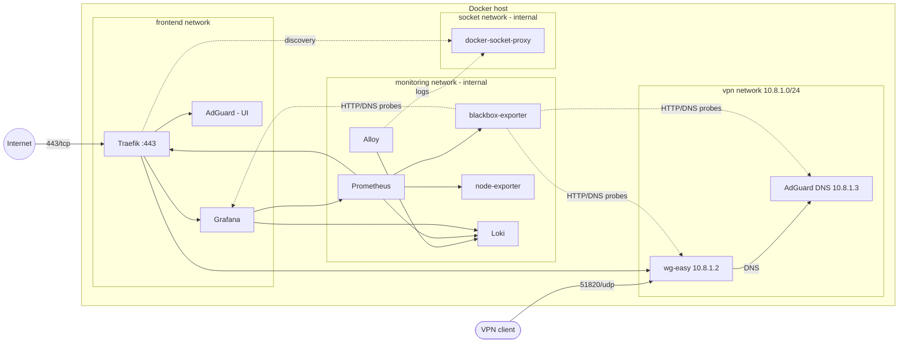

# Homelab Network Stack


Fully containerized self-hosted network infrastructure, deployable with a single command:
WireGuard VPN, filtering DNS, reverse proxy with automatic TLS, monitoring and centralized logs.

| Service | Role | URL |
|---|---|---|
| **Traefik** | Reverse proxy, Let's Encrypt certificates, security headers | `https://traefik.<domain>` |
| **wg-easy** | WireGuard server + client management UI | `https://vpn.<domain>` |
| **AdGuard Home** | Filtering DNS (ads, trackers) for VPN clients | `https://dns.<domain>` |
| **Grafana** | Metrics and logs dashboards | `https://grafana.<domain>` |
| **Prometheus** | Metrics collection, alerting rules | internal only |
| **blackbox-exporter** | HTTP and DNS availability probes | internal only |
| **node-exporter** | Host metrics (CPU, memory, disk, network) | internal only |
| **Loki + Alloy** | Centralized logs from all containers | internal only |
| **docker-socket-proxy** | Read-only access to the Docker API | internal only |

## Architecture



Only two ports are exposed on the host: **443/tcp** (Traefik) and **51820/udp** (WireGuard).
Port 80 is not opened: certificates are obtained through the TLS-ALPN challenge on port 443.

## Quick start

**Requirements**: Docker Engine 24+ with the Compose plugin, `make`, `openssl`, `curl`, and a Linux kernel
with the `ip_tables` / `iptable_nat` modules (loaded automatically by `make init`).
For a real deployment: a domain name whose `grafana`, `vpn`, `dns` and `traefik` subdomains
point to the host's public IP.

```bash
git clone https://github.com/Achref-LOUSSAIEF/homelab-network-stack.git
cd homelab-network-stack

make init     # creates .env: fill in DOMAIN, ACME_EMAIL and WG_HOST, then run make init again
make init     # generates secrets and data directories
make up       # starts the stack and configures AdGuard
make test     # checks that everything works
```

Admin passwords are generated in `secrets/` (never committed).
Then create your VPN clients at `https://vpn.<domain>`: they will automatically use AdGuard as their DNS.

Other commands: `make help`.

## Security

**Network segmentation.** Each service only joins the networks it needs:

| Network | Type | Members | Why |
|---|---|---|---|
| `frontend` | bridge | Traefik, Grafana, AdGuard (UI) | Published web interfaces |
| `vpn` | bridge | wg-easy, AdGuard (DNS), Traefik, blackbox | VPN clients can only reach DNS and the proxy |
| `monitoring` | **internal** | Prometheus, exporters, Loki, Alloy, Grafana | No Internet access, nothing published |
| `socket` | **internal** | docker-socket-proxy, Traefik, Alloy | Isolates access to the Docker API |

**Container hardening.**
- `no-new-privileges` and `cap_drop: ALL` on every service (except wg-easy, see below).
- **Non-root** execution: Traefik (65532), Alloy (65534), Grafana (472), Prometheus and
  the exporters (nobody), Loki (10001). Traefik listens on port 443 without root
  thanks to the `net.ipv4.ip_unprivileged_port_start` sysctl, scoped to its network namespace.
- **Read-only** filesystem for Traefik, Prometheus, the exporters and the Docker proxy.
- No container accesses the Docker socket directly: Traefik and Alloy go through
  `docker-socket-proxy`, which only allows read requests.
- **Documented exceptions**:
  - wg-easy runs as root with the `NET_ADMIN` capability, required to create the `wg0` interface
    and the clients' NAT rules;
  - AdGuard runs as root because it refuses to start otherwise on first launch, but with
    only `NET_BIND_SERVICE` and `NET_RAW` (all other capabilities are dropped).

**Secrets.** Randomly generated by `scripts/init.sh`, stored outside the repository in `secrets/`
(directory mode `700`) and injected through Docker Compose secrets (`*_FILE`) when the image supports it.

**TLS.** TLS 1.2 minimum, modern cipher suites, HSTS and security headers
applied to every router (`config/traefik/dynamic/security.yml`). The Traefik dashboard is protected
by basic authentication.

## Monitoring

The **Homelab – Overview** dashboard is provisioned automatically in Grafana:
- UP/DOWN status of each probe (HTTP and DNS) and each Prometheus target;
- probe latency and AdGuard DNS resolution time;
- requests and 5xx errors per service (Traefik metrics);
- host CPU, memory and network traffic;
- logs from all containers, filterable by service (Loki).

Alerting rules (`config/prometheus/rules/alerts.yml`): unreachable target, failing probe,
slow DNS, host CPU/memory/disk. They are visible in Prometheus and Grafana.

## Continuous integration

On every push, GitHub Actions:
1. checks the scripts (`shellcheck`), the YAML files (`yamllint`), the Compose file and the Prometheus configuration (`promtool`);
2. starts the full stack on the runner;
3. runs `scripts/smoke-test.sh`: every interface responds over HTTPS through Traefik, AdGuard resolves names,
   all Prometheus targets and probes are UP, Loki receives logs;
4. prints the container logs on failure, then stops the stack.

Dependabot proposes updates to the pinned Docker images every week.

## Project layout

```
compose.yml                  stack definition
.env.example                 variables to fill in
Makefile                     common commands
scripts/
  init.sh                    secrets + data directories
  adguard-setup.sh           initial AdGuard configuration through its API
  smoke-test.sh              end-to-end tests
config/
  traefik/dynamic/           middlewares and TLS options
  prometheus/                scraping, probes, alerting rules
  blackbox/                  HTTP and DNS probe modules
  loki/  alloy/              log storage and collection
  grafana/                   provisioned datasources and dashboard
docs/troubleshooting.md      known issues and diagnostics
```

## Troubleshooting

See [docs/troubleshooting.md](docs/troubleshooting.md).