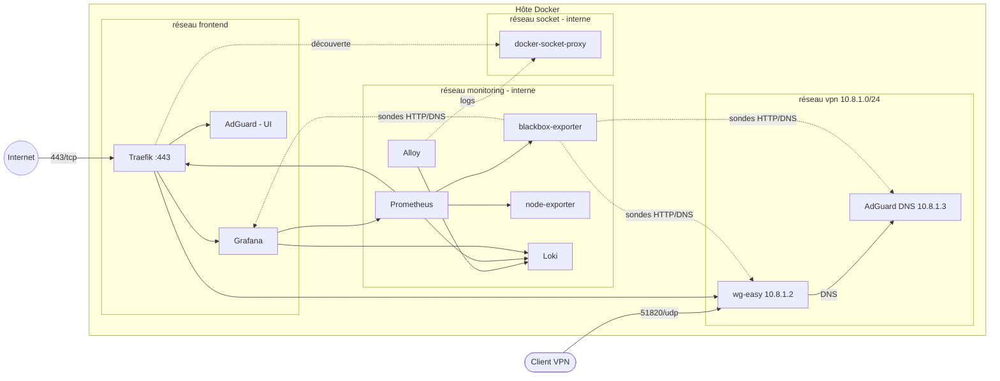

# Homelab Network Stack


Infrastructure réseau self-hosted entièrement conteneurisée, déployable en une seule commande :
VPN WireGuard, DNS filtrant, reverse proxy avec TLS automatique, supervision et logs centralisés.

| Service | Rôle | URL |
|---|---|---|
| **Traefik** | Reverse proxy, certificats Let's Encrypt, en-têtes de sécurité | `https://traefik.<domaine>` |
| **wg-easy** | Serveur WireGuard + interface de gestion des clients | `https://vpn.<domaine>` |
| **AdGuard Home** | DNS filtrant (pubs, trackers) pour les clients VPN | `https://dns.<domaine>` |
| **Grafana** | Dashboards métriques + logs | `https://grafana.<domaine>` |
| **Prometheus** | Collecte des métriques, règles d'alerte | interne uniquement |
| **blackbox-exporter** | Sondes de disponibilité HTTP et DNS | interne uniquement |
| **node-exporter** | Métriques de l'hôte (CPU, mémoire, disque, réseau) | interne uniquement |
| **Loki + Alloy** | Centralisation des logs de tous les conteneurs | interne uniquement |
| **docker-socket-proxy** | Accès en lecture seule à l'API Docker | interne uniquement |

## Architecture



Seuls deux ports sont exposés sur l'hôte : **443/tcp** (Traefik) et **51820/udp** (WireGuard).
Le port 80 n'est pas ouvert : les certificats sont obtenus par challenge TLS-ALPN sur le port 443.

## Démarrage rapide

**Prérequis** : Docker Engine 24+ avec le plugin Compose, `make`, `openssl`, `curl`, et un noyau Linux
avec les modules `ip_tables` / `iptable_nat` (chargés automatiquement par `make init`).
Pour un déploiement réel : un nom de domaine dont les sous-domaines `grafana`, `vpn`, `dns`
et `traefik` pointent vers l'IP publique de l'hôte.

```bash
git clone https://github.com/Achref-LOUSSAIEF/homelab-network-stack.git
cd homelab-network-stack

make init     # crée .env : renseigne DOMAIN, ACME_EMAIL et WG_HOST, puis relance make init
make init     # génère les secrets et les répertoires de données
make up       # démarre la stack et configure AdGuard
make test     # vérifie que tout fonctionne
```

Les mots de passe d'administration sont générés dans `secrets/` (jamais versionné).
Ensuite, crée tes clients VPN sur `https://vpn.<domaine>` : ils utiliseront automatiquement AdGuard comme DNS.

Autres commandes : `make help`.

## Sécurité

**Segmentation réseau.** Chaque service ne rejoint que les réseaux dont il a besoin :

| Réseau | Type | Contenu | Pourquoi |
|---|---|---|---|
| `frontend` | bridge | Traefik, Grafana, AdGuard (UI) | Interfaces web publiées |
| `vpn` | bridge | wg-easy, AdGuard (DNS), Traefik, blackbox | Les clients VPN n'atteignent que le DNS et le proxy |
| `monitoring` | **internal** | Prometheus, exporters, Loki, Alloy, Grafana | Aucun accès Internet, rien n'est publié |
| `socket` | **internal** | docker-socket-proxy, Traefik, Alloy | Isole l'accès à l'API Docker |

**Durcissement des conteneurs.**
- `no-new-privileges` et `cap_drop: ALL` sur tous les services (sauf wg-easy, voir ci-dessous).
- Exécution **non-root** : Traefik (65532), Alloy (65534), Grafana (472), Prometheus et
  les exporters (nobody), Loki (10001). Traefik écoute sur le port 443 sans être root
  grâce au sysctl `net.ipv4.ip_unprivileged_port_start`, limité à son namespace réseau.
- Système de fichiers en **lecture seule** pour Traefik, Prometheus, les exporters et le proxy Docker.
- Aucun conteneur n'accède directement au socket Docker : Traefik et Alloy passent par
  `docker-socket-proxy`, qui n'autorise que les requêtes en lecture.
- **Exceptions documentées** :
  - wg-easy tourne en root avec la capacité `NET_ADMIN`, nécessaire pour créer l'interface `wg0`
    et les règles NAT des clients ;
  - AdGuard tourne en root car il refuse de démarrer autrement au premier lancement, mais avec
    seulement `NET_BIND_SERVICE` et `NET_RAW` (toutes les autres capacités sont retirées).

**Secrets.** Générés aléatoirement par `scripts/init.sh`, stockés hors du dépôt dans `secrets/`
(répertoire en `700`) et injectés via les secrets Docker Compose (`*_FILE`) quand l'image le permet.

**TLS.** TLS 1.2 minimum, suites de chiffrement modernes, HSTS et en-têtes de sécurité
appliqués à tous les routeurs (`config/traefik/dynamic/security.yml`). Le dashboard Traefik est protégé
par authentification basique.

## Supervision

Le dashboard **Homelab – Vue d'ensemble** est provisionné automatiquement dans Grafana :
- état UP/DOWN de chaque sonde (HTTP et DNS) et de chaque cible Prometheus ;
- latence des sondes et temps de résolution DNS d'AdGuard ;
- requêtes et erreurs 5xx par service (métriques Traefik) ;
- CPU, mémoire et trafic réseau de l'hôte ;
- logs de tous les conteneurs, filtrables par service (Loki).

Règles d'alerte (`config/prometheus/rules/alerts.yml`) : cible injoignable, sonde en échec,
DNS lent, CPU/mémoire/disque de l'hôte. Elles sont visibles dans Prometheus et Grafana.

## Intégration continue

À chaque push, GitHub Actions :
1. vérifie les scripts (`shellcheck`), les YAML (`yamllint`), le fichier Compose et la configuration Prometheus (`promtool`) ;
2. démarre la stack complète sur le runner ;
3. lance `scripts/smoke-test.sh` : chaque interface répond en HTTPS via Traefik, AdGuard résout des noms,
   toutes les cibles et sondes Prometheus sont UP, Loki reçoit les logs ;
4. affiche les logs des conteneurs en cas d'échec, puis arrête la stack.

Dependabot propose chaque semaine une mise à jour des images Docker épinglées.

## Arborescence

```
compose.yml                  définition de la stack
.env.example                 variables à renseigner
Makefile                     commandes courantes
scripts/
  init.sh                    secrets + répertoires de données
  adguard-setup.sh           configuration initiale d'AdGuard via son API
  smoke-test.sh              tests de bout en bout
config/
  traefik/dynamic/           middlewares et options TLS
  prometheus/                scraping, sondes, règles d'alerte
  blackbox/                  modules de sondes HTTP et DNS
  loki/  alloy/              stockage et collecte des logs
  grafana/                   datasources et dashboard provisionnés
docs/troubleshooting.md      problèmes rencontrés et diagnostic
```

## Dépannage

Voir [docs/troubleshooting.md](docs/troubleshooting.md).

## Licence

MIT